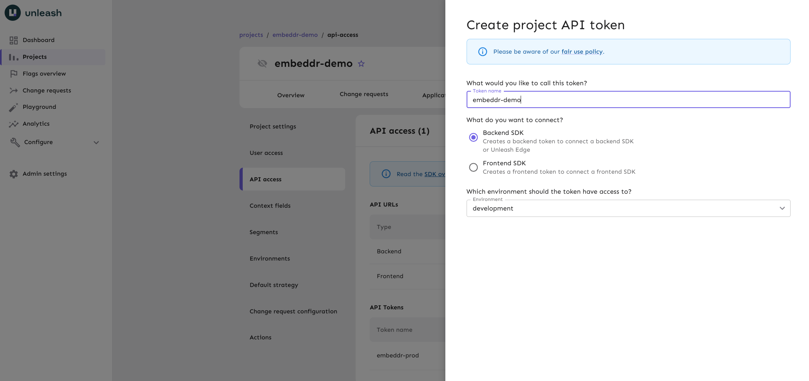
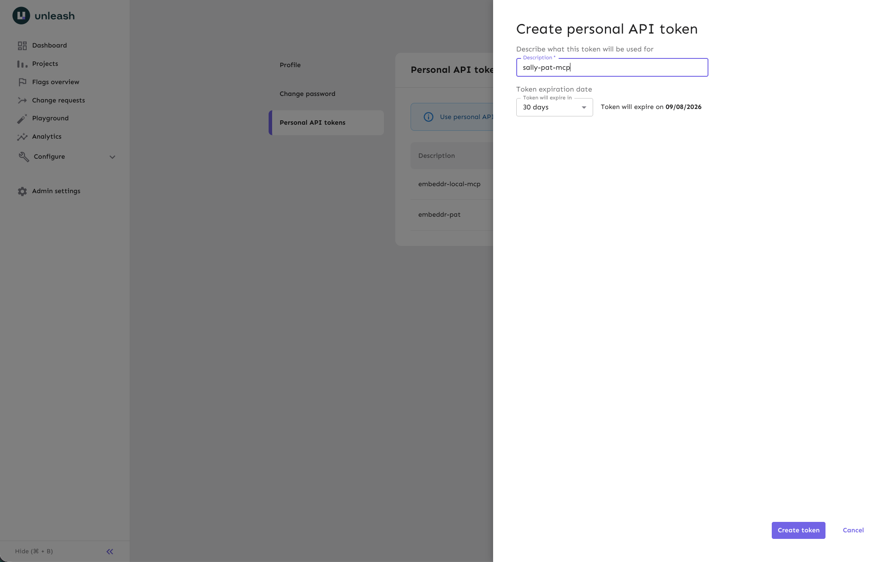
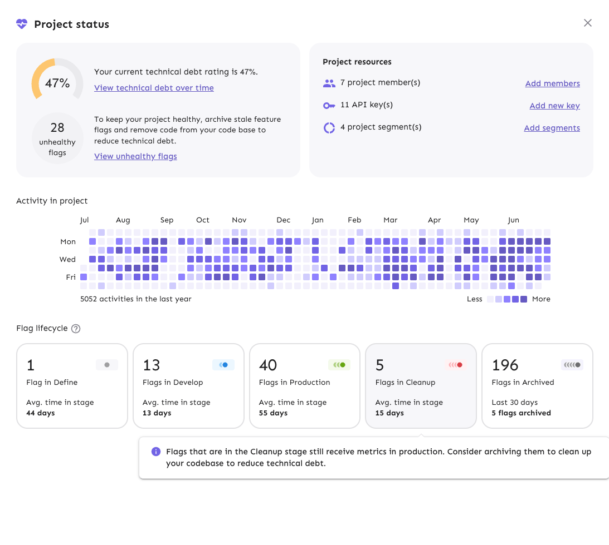

# Workshop workbook: Runtime Control with AI, Java edition

This workbook takes you through the whole workshop: setting up, wiring your
first flag by hand, building a feature with your AI assistant, and then
running an experiment, a safeguard and a change request against your own
copy of the app.

Work at your own pace. Each part ends with a checkpoint that tells you how to
verify your progress before moving on. If you get stuck, raise a hand, ask
your neighbor, or use the fallback commands in [FALLBACKS.md](FALLBACKS.md).
Every assistant-driven step has a fallback command, so a misbehaving
assistant never blocks you.

On Windows, replace `./gradlew` with `gradlew.bat` throughout.

## What you are going to do

Embeddr is a dating app for AI agents. It has a React frontend and a Spring
Boot backend, with feature flags evaluated on the backend through Unleash.

1. Set up: run Embeddr, connect it to Unleash, and connect your AI assistant
   through the [Unleash MCP server](https://docs.getunleash.io/integrate/mcp).
2. Wire up your first flag by hand: the waitlist you saw at the start.
3. Ask your assistant to build Embeddr Premium, wrapped in flags from the
   start, and rescue it with a kill switch when the payment provider fails.
4. Run an A/B test with a success metric.
5. Attach a safeguard to a flag and watch it turn the flag off on its own.
6. Ship a change through a change request your neighbor approves.
7. Optionally, retire a flag when you are done with it.

## Part 0: before the workshop

You need a laptop with git, a JDK (17 or newer), and an AI coding assistant
that supports MCP. Gradle downloads everything else, including the JDK 21
the app compiles with and the Node the frontend builds with.

Clone the repo and run the pre-check once on a network that works. It
downloads what the day needs and caches it:

```bash
git clone https://github.com/Unleash/embeddr-workshop-java.git
cd embeddr-workshop-java
./gradlew precheck
```

The pre-check fails on the missing `.env` at this point. That is expected;
the downloads happened. If it fails earlier, on the JDK or on a download,
see the proxy notes in [README.md](README.md).

## Part 1: set up

### Sign in and find your project

1. Check your email for the invitation to the workshop Unleash instance and
   sign in.
2. In the Unleash UI, open **Projects** and find the project named after you:
   first name, last initial, for example `Melinda F`. Open it and note the
   project id in the address bar, for example `melinda-f`. You need it twice.

### Create the backend token

The app's backend evaluates flags with its own token, scoped to your project.

1. In your project, go to **Settings**, then **API access**, then
   **New API token**.
2. Choose the **Backend** token type.
3. Scope it to the `development` environment, and create it.



4. Copy the token. It looks like `melinda-f:development.xxxx`.

### Create your personal access token

Your assistant talks to the
[remote MCP server](https://docs.getunleash.io/integrate/mcp) hosted by the
workshop instance. To authenticate with it, create a personal access token.

1. Select your profile icon, then **Profile settings**, then
   **Personal API tokens**, then **New token**. Create it and copy it. It
   starts with `user:`.



### Fill in .env

All local configuration lives in one file.

```bash
cp .env.example .env
```

Open `.env` and fill in the four values:

| Variable | Value |
|----------|-------|
| `UNLEASH_URL` | The instance you signed in to: everything in the address bar before `/projects`, no trailing slash |
| `UNLEASH_BACKEND_TOKEN` | The backend token |
| `UNLEASH_FLAG_SUFFIX` | Your project id, for example `melinda-f` |
| `UNLEASH_PAT` | The personal access token |

The suffix is there because flag names are unique across the shared
instance. Every flag you create today is named `<flag>-<your project id>`.
The Java code keeps using short names like `early-access`; the wrapper adds
the suffix.

### Check, configure, run

```bash
./gradlew precheck
./gradlew configure
./gradlew bootRun
```

`precheck` verifies both tokens against the instance and tells you exactly
which value is wrong if one is. `configure` writes the MCP config for every
supported assistant from the values in `.env`:

| Assistant | Config file |
|-----------|-------------|
| Claude Code | `.mcp.json` |
| Cursor | `.cursor/mcp.json` |
| VS Code Copilot | `.vscode/mcp.json` |
| OpenCode | `opencode.json` |
| Codex | `.codex/config.toml` |
| Gemini CLI | `.gemini/settings.json` |

These files hold your token and are gitignored. Restart your assistant so it
picks up the config.

Open `http://localhost:8080`. You should see profile cards of AI agents
looking for love. The terminal should log `flags: synchronized with ...`
with your suffix in quotes.

**Checkpoint 1.** The app renders at `localhost:8080`, the log shows
`flags: synchronized`, and your assistant lists Unleash tools when you ask
it what tools it has.

### If something is off

| Symptom | Likely cause |
|---------|--------------|
| `precheck` says the backend token is rejected | Token scoped to the wrong project or environment, or `UNLEASH_URL` has a path after the instance, like `/api` or `/projects` |
| `precheck` says the personal access token is rejected | You pasted the backend token into `UNLEASH_PAT`. The PAT starts with `user:` |
| The log warns that `UNLEASH_URL` is not set | `.env` is missing or still has empty values |
| The assistant shows no Unleash tools | Run `./gradlew configure` again and restart the assistant. The endpoint URL ends in `/api/admin/mcp` |
| Tool calls fail with `401 Unauthorized` | Wrong token in `.env` under `UNLEASH_PAT`. Fix it and run `./gradlew configure` again |

## Part 2: your first flag, by hand

At the start of the session the room queued at a waitlist and was let in a
few people at a time. Now build that door yourself. No assistant yet: one
flag in the UI, one line of Java.

### Create the flag

1. In your project, select **New feature flag**.
2. Name it `early-access-<your project id>`, for example
   `early-access-melinda-f`. Type **Release**. Create it. Leave it off.

### Wire it up

Open `src/main/java/io/getunleash/embeddr/api/AccessController.java`. The
door is wide open: the endpoint returns `true` for everyone. The controller
already has the two things it needs, a `FeatureFlags` wrapper and a
`Visitor` built from the session and the invite code. Replace the return
line:

```java
return new AccessResponse(flags.isEnabled("early-access", visitor));
```

Short name, no suffix. The wrapper appends `-<your project id>` and asks the
Unleash SDK, which evaluates the flag in memory from the project it fetched a
few seconds ago. Read `flags/UnleashFeatureFlags.java` if you want to see
exactly where that happens; it is the only class that imports Unleash.

Stop `bootRun` with Ctrl-C and start it again. Reload the browser. The
waitlist page is back, and this time it is yours.

### Let yourself in

1. Type your first name as the invite code and press Enter. The page says
   you are in the queue and watches the door. The code you typed is now the
   Unleash userId on every request from this browser.
2. In the Unleash UI, open your flag. In the **development** environment,
   select **Add strategy**, then **Gradual rollout**.
3. In the **Targeting** tab, add a constraint: context field `userId`,
   operator `IN`, value your first name, exactly as you typed it. Keep the
   rollout at 100 percent. Save the strategy.
4. Turn the development environment on.
5. Watch the app. Within a few seconds the door opens and the cards appear.

Have your neighbor open `http://localhost:8080` on their laptop against your
backend? They cannot, it is your localhost. Instead, open a private browser
window, type a different code, and watch it wait at the door. That is one
flag admitting one person, by user id, with everybody else held outside.

**Checkpoint 2.** `early-access-<your project id>` exists, is on in
development with a userId constraint, your browser is through the door, and
a private window with another code is not.

### If something is off

| Symptom | Likely cause |
|---------|--------------|
| The door never opens | The constraint value does not match what you typed, or the environment toggle is still off, or you forgot to restart `bootRun` after the code change |
| Everyone gets in | The strategy has no constraint, or the flag name in Unleash is missing your suffix and does not match what the wrapper asks for |
| Compile error on restart | The line needs `flags` and `visitor`, both already declared above it in the method |

## Part 3: build a feature with your assistant

Embeddr wants to monetize. The free tier shows six matches; Embeddr Premium
promises the rest of the embedding space, for a price. Product is excited.
Finance is more excited. Let's see.

1. Give your assistant this prompt:

   ```text
   Add an embeddr premium upsell that shows a premium call to action in the
   match grid inviting the user to subscribe to see more models. Hook it up
   to our payment provider. Also add a kill switch for the payment provider
   in case it misbehaves (fallback to an async queue so we can follow up
   later).
   ```

2. Watch what the assistant does. Notice the prompt never says the words
   feature flag. Deciding that this change needs one is the assistant's job.
   Expect it to:

   - evaluate the change through the MCP server and decide it needs a
     release flag for Premium and an operational flag for the kill switch
   - create both in your project, suffixed with your project id, like
     `premium-upsell-melinda-f` and `payment-kill-switch-melinda-f`
   - write a controller that serves the call to action only when the
     Premium flag is on, an upgrade endpoint that charges through
     `POST /payment` unless the kill switch is on, in which case it queues
     the request, and the frontend that renders it all

3. Verify its work in the Unleash UI: your project shows two new flags,
   both off.

4. Restart `bootRun`. If the assistant changed files under `web/`, it ran
   `./gradlew web`; if not, the restart builds the frontend anyway. Look at
   the app. No call to action anywhere yet. The code is there. The feature
   is not released.

**Checkpoint 3.** Two new flags exist in your project, turned off, and the
app shows no premium call to action.

### Release it, break it, rescue it

1. Turn the Premium flag on in development with a gradual rollout at 100
   percent, in the UI or by prompt:

   ```text
   Turn on the premium flag in the development environment with a gradual
   rollout at 100 percent.
   ```

2. Within a few seconds the call to action appears. Tap **Upgrade**. The
   payment provider thinks for a second and fails. It always fails; it is
   built that way. In real life this is the Monday morning incident.

3. You have two runtime moves and no deploy in either. First the kill
   switch: turn `payment-kill-switch-<your project id>` on. Tap Upgrade
   again. The request lands in the queue, the user gets a friendly message,
   and finance follows up later.

4. Second, if Premium itself had to go: turn the Premium flag off. The call
   to action vanishes while the app keeps running.

**Checkpoint 4.** You watched Upgrade fail, flipped the kill switch and
watched it succeed, then turned Premium off and watched the call to action
disappear, all without restarting anything.

### If something is off

| Symptom | Likely cause |
|---------|--------------|
| The assistant cannot decide where to create the flag | Not a failure. Tell it your project id |
| The assistant created the flag without your suffix | Ask it to archive that one and create `premium-upsell-<your project id>`. Or create the flag yourself with FALLBACKS.md and ask only for the code |
| The flag is on but nothing shows | The name in Unleash and the short name in Java do not line up once the suffix is added, or `bootRun` was not restarted after the code change |
| The assistant started a server or ran a build that failed | Stop it, restart `bootRun` yourself, and ask it to fix the specific compile error you see |

**If your assistant misbehaves:** create the flags yourself with the
create-flag command in FALLBACKS.md, then ask the assistant to write only
the code. If the code is wrong, ask it to fix the specific problem you see.
You do not need to start over.

## Part 4: run an experiment

Embeddr wants to know how people prefer to browse matches: the classic
grid, or one profile at a time. The code for both layouts is already in the
app, and so is the success metric: every Match tap is counted under the
layout that served it. All that is missing is the flag.

1. Create a flag named `match-layout-experiment-<your project id>`, type
   **Experiment**.
2. In the development environment, add a **Gradual rollout** strategy at
   100 percent. In the strategy's **Variants** tab, add two variants,
   `list` and `deck`, with equal weights. Save, and turn the environment
   on.
3. Reload the app, then open one or two private windows. Each window is its
   own session, and each session sticks to its side of the split. At least
   one of them should show the deck: one profile at a time, with Pass and
   Match.
4. Tap **Match** a few times in each window.
5. In the Unleash UI, open the impact metrics view and chart
   `match_count_list_<suffix>` and `match_count_deck_<suffix>`, with the
   suffix in underscores, for example `match_count_deck_melinda_f`. The
   presenter shows where. Within a minute the two lines sit side by side.

The variant name travels from Unleash, through `flags.variant(...)` in
`LayoutController`, to the frontend, which picks the component. The tap
travels back through `MatchController`, which asks for the same variant and
counts under it. Nothing in the frontend knows there is an experiment.

**Checkpoint 5.** Two windows show two layouts, and the two match counters
move independently in Unleash.

## Part 5: let a safeguard protect the flag

Auto-Rizz writes an opening line on every match card. Users can tap **Ick**.
Every tap bumps the `thumbs_down_count` impact metric. In this part you
roll the feature out, then attach a safeguard that turns it off when the
room hates it, and then you become the room.

1. Create a flag named `auto-rizz-<your project id>`, type **Release**.
2. In development, add a gradual rollout at 100 percent and turn the
   environment on. Reload the app: every card has an opener, and an Ick
   button.
3. Tap Ick once, so the metric exists. The app reports metrics every five
   seconds.
4. In the flag's development environment, add a **Safeguard**. Pick the
   metric `thumbs_down_count_<suffix>`, aggregation **Count**, a threshold of
   3, over the shortest window offered. The action is to disable the
   environment. The presenter walks through the dialog on screen.
5. Tap Ick four more times. Watch the flag. Within a minute the safeguard
   trips, the environment turns off, and the openers vanish from your app.
   Nobody at the keyboard.

This is the demo from the start of the session, running in your project
against your app. What you did by hand in part 3 is what the safeguard does
on its own.

**Checkpoint 6.** The development environment of your Auto-Rizz flag shows
it was disabled by the safeguard, and the openers are gone from the app.

## Part 6: ship through a change request

In production, nobody flips flags alone. The organisers enabled change
requests on the development environment of every project for this part,
and made you a member of your neighbor's project. Pair up.

1. Create a flag named `light-mode-<your project id>`, type **Release**. It
   gates the theme toggle in the header; the code is already wired.
2. In development, add a gradual rollout at 100 percent and turn the
   environment on. Nothing happens yet: both changes landed in a draft
   change request instead of in the environment.
3. Open the draft, add a short description, and submit it for review.
4. Your neighbor opens your project, finds the change request under
   **Change requests**, reviews it, approves it, and applies it.
5. Watch your app: the theme toggle appears in the header. Then do the same
   for your neighbor.

**Checkpoint 7.** Your light mode change request shows approved and applied
by someone other than you, and the toggle is in your header.

## Part 7 (optional): retire a flag

A release flag like Premium is supposed to be temporary: once the feature
is fully rolled out and stable, the flag becomes debt. Unleash tracks this
as a lifecycle: **Define**, **Develop**, **Production**, **Cleanup**,
**Archived**.



1. Open your Premium flag and find its lifecycle stage. Hover over it and
   select **Mark ready for cleanup**.
2. Ask your assistant:

   ```text
   Embeddr Premium is now fully rolled out. Remove the flag from the code.
   ```

3. Restart `bootRun`, archive the flag in the Unleash UI yourself, and
   verify the call to action still renders. Keep the kill switch: that one
   is operational and permanent.

**Checkpoint 8.** The Premium flag went develop, cleanup, archived, and the
feature still works as a permanent part of the app.

## What you just did

- Set up a Java app that evaluates feature flags on the backend, behind one
  small wrapper, and ran it from one Gradle command.
- Wired a flag by hand and admitted one user by id.
- Built a feature with an AI assistant that wrapped its own work in flags,
  through the Unleash MCP server, and rescued a failing dependency with a
  kill switch.
- Ran an experiment with a success metric, and let a safeguard turn a
  feature off on its own.
- Shipped a change through a review, and retired a flag.

Runtime control scales from one person with a flag to a system that
protects itself, and it ends in governance.

## Where to go next

- Play with the rollout: set `early-access` to a 20 percent gradual rollout
  with userId stickiness and have a few private windows with different codes
  watch the door. Raise it to 50, then 100.
- Replace the plain Premium flag with a release plan: three milestones,
  internal only, then 10 percent, then 100 percent, stepped through from the
  UI while the app is open.
- Add two variants with different call to action copy to the Premium flag,
  then ask your assistant to make the backend serve the variant payload and
  the frontend render it.
- Read `flags/UnleashFeatureFlags.java` and move the wrapper into your own
  codebase. It is one interface and one class.
